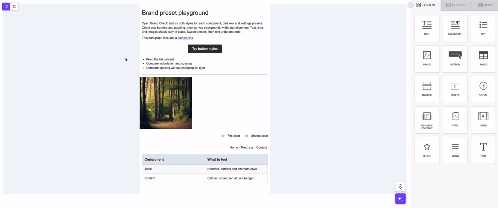
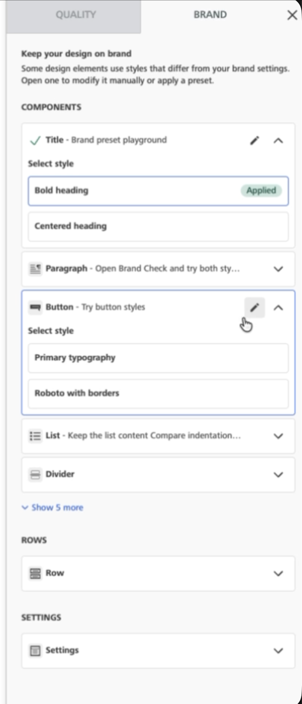

# Brand Check


Brand Check is available for customers on Superpowers and Enterprise plans, for email designs only.&#x20;


### Overview

Brand Check is a built-in, ready-made widget that gives your end users actionable feedback on whether their email designs are on-brand, from inside the editor.

[Quality Check](quality-check.md) validates against a single, fixed set of rules that applies to everyone. Brand Check validates against rules your users define as presets: named, reusable combinations of properties (like background color and text color together) for buttons, paragraphs, rows, and more.

<figure><figcaption></figcaption></figure>

### Availability

Brand Check is available for **email designs only**.

Activation works the same way as Quality Check, plus there's an additional control that allows you to set which users get this check.

Three independent things must be true for an end user to see Brand Check:

1. The Brand Check toggle is enabled in your Developer Console (Application configuration → QA tools, below Quality Check). It's off by default for every app.
2. The `brandCheck.enabled` config parameter is `true` for that specific end user. It's `true` by default, so you only need to set it explicitly to turn Brand Check off for specific customers.
3. A valid `brandRules` object is included when the editor starts if there's at least one preset in it that still applies after advanced-permission filtering (see Permissions section). Having a `presets` entry alone isn't enough: `columns`-only presets, or presets that only set MCP/Copilot-only fields, don't count since Brand Check never reads either.

Preset validation is all-or-nothing: if even one field in `brandRules` doesn't match the schema (for example, a string appears where a number is expected), the whole object is treated as invalid. Additionally, if any of the three conditions above aren't met, the Brand Check tab won't appear for your users. We trigger the same `onError` callback used elsewhere for invalid configuration, so you'll be able to detect and debug any issues. See [Error management](../resources/error-management/) for the full list of codes.


If you'd rather build a fully custom brand-validation experience instead, Brand Check has its own dedicated public API endpoint, separate from the Check CSAPI endpoint Quality Check uses.&#x20;


Quality Check and Brand Check are two separate products. Using either one through the built-in widget has no additional cost: the API calls the widget makes are not billed. If you call a checker's public API endpoint directly, those calls are billed and count toward your CSAPI allotment.

### How it works

#### Running a check

Brand Check lives in the same Checker panel as Quality Check, just as a separate tab. Clicking the shield icon in the editor opens the panel, then your users switch to the Brand tab to see brand-specific results.

The Checker panel can be programmatically opened or closed with a [frontend command](../other-customizations/frontend-commands.md), allowing it to be triggered from a custom touchpoint instead of the shield icon. This command only opens or closes the panel. It can't specify which tab (Quality or Brand) opens; the end user still switches tabs manually once it's open. The shield icon itself can be hidden with [custom CSS](../other-customizations/appearance/custom-css/css-changes.md#brand-check).

Each tab's check runs independently, triggered by clicking the shield icon or by clicking that tab in the sidebar. Checks don't run simultaneously across both tabs. If your user applies a fix, switches to the Quality tab, then returns to Brand, the check reruns.

#### Understanding the results

If no block in the design matches any preset's target (i.e. the design doesn't use any buttons, and the only presets are for buttons), the Brand tab shows nothing flagged for that design.

Brand Check lists one card per element that doesn't match one of the presets, in the order the blocks appear in the template. Cards are collapsed by default; once your user expands one, it stays expanded until they collapse it again. Clicking a card the first time highlights the corresponding element on the stage.

<figure><figcaption></figcaption></figure>

Each card shows:

* The element that's off-brand
* The preset(s) available for it, so your user can pick which one to apply (there's no preview before applying)
* A pencil icon that opens that element's properties in the sidebar, for manual edits

A card not showing for a given preset doesn't mean that preset is missing from your `brandRules`. Brand Check only ever surfaces presets tied to an actual off-brand issue; there's no mode in Brand Check that lists every preset in a configuration.

Once a user applies a preset, the card shows an Applied state, and the element's icon in the editor switches to a checkmark to show which elements have been updated. Brand Check doesn't automatically recheck on every change made by other collaborators (see [Co-editing](brand-check.md#co-editing)).

#### Applying or editing a fix

Your users have two ways to resolve a flagged element:

1. **Apply a preset.** Clicking a preset in the card applies all the defined properties in a single click. In a co-editing session, this briefly locks the element, applies the change, then releases the lock automatically.
2. **Edit manually.** Clicking the pencil icon takes them to that element's properties in the sidebar, so they can adjust it by hand instead.


**A note about presets:** Applying a preset only touches the fields it defines, the same way a manual edit would, so switching between two presets on the same element can leave a mix of both behind instead of a clean switch. See the Brand Rules JSON schema for why this happens and how to avoid it in your presets.


### Setting up brand rules

Brand Check reads its rules from the same `brandRules` object used by Brand Rules for AI: a `presets` structure defining named, pre-approved styles for blocks, rows, and settings. See the Brand Rules JSON schema for the full, block-by-block breakdown.

Here's an example that defines a single approved button style:

```json
{
  "brandRules": {
    "presets": {
      "blocks": {
        "button": {
          "brandButton": {
            "label": "Primary button",
            "properties": {
              "backgroundColor": "#1A73E8",
              "color": "#FFFFFF",
              "borderRadius": "4px",
              "fontWeight": "700"
            }
          }
        }
      }
    }
  }
}
```

A few things to note:

* `label` is Brand Check only: it's the name your users see on the preset in the panel. We strongly recommend setting it explicitly rather than relying on the auto-generated default ("Style 1", "Style 2", and so on, incrementing per preset).
* If you use Brand Check alongside API-managed MCP sessions (co-editing), keep both in sync: MCP and Brand Check read `brandRules` through separate channels in that setup, so configuring them differently can cause the AI and the checker to validate against different presets.
* If a preset specifies a font not available in the editor's font catalog, the whole Brand Check is hidden for that design, the same `onError` callback used for an invalid `brandRules` object fires. See the Brand Rules JSON schema for the general font-matching rule and how presets are compared against a component's own properties.

### JSON schema

Brand Check and Brand Rules for AI read the same `brandRules` schema, but not the same fields. See the [Brand Rules JSON schema](../data-structures/brand-rules-schema.md) for the complete, block-by-block list of what Brand Check checks versus what's MCP/Copilot only.

### Customization


CSS-based styling is available to Superpowers and Enterprise plans.


You can use [Custom CSS](../other-customizations/appearance/custom-css/) to customize styles for Brand Check. It shares its CSS selectors with Quality Check (the checker panel, pencil icon, and chevron), plus a few additions specific to Brand Check:

* The preset choices shown inside a card
* The chevron that expands and collapses a card
* The Applied indicator

Copy customization works the same way as Quality Check: pass Translation configuration parameters to override the panel's labels. Preset names themselves come from each preset's `label`, with "Style 1", "Style 2", and so on as the default when unset.

Icons are inherited from the content tab at the SDK level, but custom CSS you've already applied to the content tab's icons doesn't carry over automatically. You'll need to apply the same rules separately for the checker.

A few things you can't customize in this iteration: moving Brand Check before Quality Check in the panel, the font (inherited from the editor theme), or adding an issue-count badge to the shield icon.

### Co-editing

Brand Check works in co-editing sessions, with a couple of differences from manual editing:

* **Applying a preset** is the first Brand Check action that changes content without your user first selecting it on the stage. It briefly locks the element, applies the change, then releases the lock automatically.
* **Locked elements:** if another user is already editing an element, or the element is a synced row, clicking its preset shows a toast instead of applying the change, the same behavior as Quality Check. If the element was deleted in the meantime, applying the preset fails and shows an error toast instead.
* **Staying in sync:** if a collaborator changes an element after a preset was applied to it, the card can keep showing Applied until your user manually reruns the check. Brand Check doesn't automatically recheck on every change made by other collaborators. If two users apply different presets to the same element before a recheck, the latest one wins.

### Permissions

Brand Check respects the same advanced permissions as manual editing. If a user's permissions restrict any property of a block (for example, they can edit a button's text but not its background color), that block's presets are removed from the list entirely. Presets for blocks the user can edit are unaffected.

If every preset ends up filtered out this way, the Brand tab doesn't show for that user (the same as if no valid brand rules were configured).

Only edit-related permissions hide Brand Check for a block: `Lock`, `CanSelect`, and `CanViewSidebar` and `show:false`. `CanDelete`, `CanAdd`, `CanClone`, and `CanMove` have no effect on whether its presets show.

### Limitations

* Brand Check is available for email designs only; it isn't available for page or Pop-up designs.
* Inline styles applied through the rich text editor (TinyMCE), like selecting a few words and changing just their color, aren't checked. Brand Check only validates each block's main style properties.
* Custom social icons (uploaded images) aren't checked: social presets only define an icon style from the supported icon collections, so a custom icon can't be matched or changed by a preset.
* Brand Check runs against the primary language of the design. Multi-language template alternatives aren't currently supported, consistent with Quality Check.
* `permissions`, `limits` are the two top-level groups in your `brandRules` object; `description` is a field within each individual preset. All three are AI-only and have no effect on Brand Check. They tell the AI what it can edit, how much content fits, and when to use a given preset, none of which a deterministic match/no-match check needs.
* If results can't load, both checkers show the same fallback message: "Unable to load check results. Please refresh or try again in a moment."
